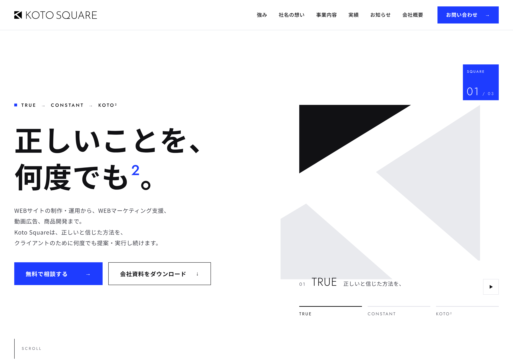
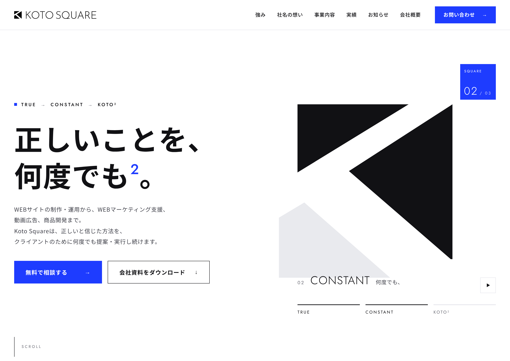
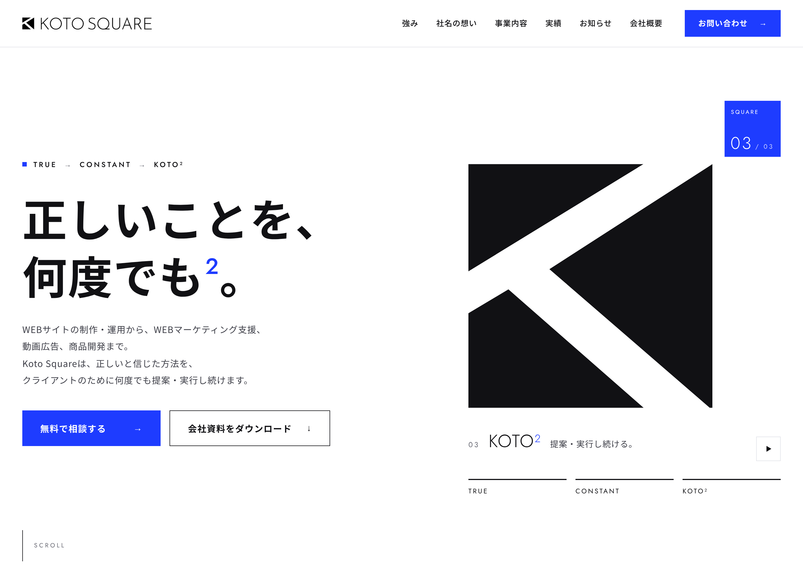

# kotosquare-

Koto Square コーポレートサイト TOPページ デザイン案（コンペ用）

※ 掲載している会社情報・実績・お知らせの内容はダミーです。

## PC版（全体）

## スマートフォン版（全体）

## ヒーローの3段階（TRUE → CONSTANT → KOTO²）
  

## ファイル
- `docs/index.html` … PC版（動くページ。GitHub Pagesで公開すると動きも見られます）
- `docs/sp.html` … スマートフォン版（PCから見る場合は `sp.html?sp`）
- `design/` … 元のデザインデータ（Claude デザインキャンバス形式）
- `export/` … 提出用の画像
- `handoff/` … 分析・改善計画の資料
